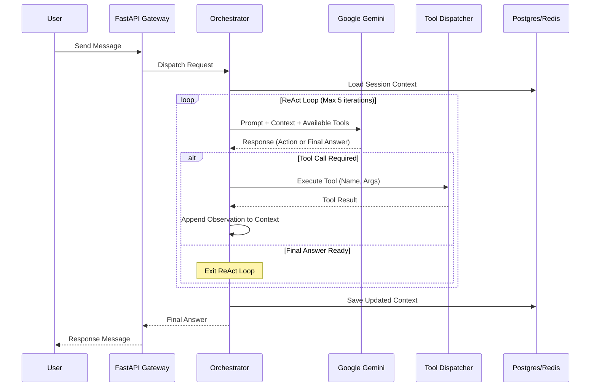

# Design & ADRs: FEAT-001 Core Agent Orchestrator

## 1. Architecture Overview
The Agent Orchestrator acts as the middle tier between the user-facing chat API and the backend tools (databases, third-party APIs). It handles context management, LLM inference, and tool execution orchestration.

### Sequence Diagram: ReAct Loop

## 2. Architecture Decision Records (ADRs)

### ADR-01: Agent Architecture Pattern
**Context:** We need a robust mechanism for the LLM to understand a query, break it down, fetch data, and provide an answer.
**Options:**
1.  **ReAct (Reason + Act):** Interleaves reasoning (thoughts) with actions (tool calls). The model decides its next move based on the previous tool's output.
2.  **Plan-and-Execute:** The model creates a complete step-by-step plan upfront, then a separate executor runs the plan.
3.  **Tree-of-Thought:** Explores multiple reasoning paths in parallel and evaluates them.
**Decision:** **ReAct loop**.
**Pros/Cons:**
*   ReAct is highly dynamic and handles unpredictable APIs well (e.g., if a transaction API returns an error, the agent can retry or adjust its approach).
*   Plan-and-Execute struggles if step 2 depends heavily on the exact output of step 1.
*   Tree-of-Thought is too slow and expensive for synchronous customer support.

### ADR-02: LLM Provider Selection
**Context:** We need a foundation model capable of strong reasoning, high-quality tool calling, and long context windows.
**Options:**
1.  **Google Gemini (Pro/Flash):** Native function calling, massive context window (1M+ tokens), fast inference.
2.  **OpenAI GPT-4o:** Industry standard, excellent reasoning.
3.  **Anthropic Claude 3.5 Sonnet:** Excellent formatting and reasoning.
4.  **Self-hosted Open-Source (Llama 3):** Highest privacy, lowest ongoing cost, but high infrastructure overhead.
**Decision:** **Google Gemini API** (via google-genai SDK).
**Pros/Cons:**
*   Gemini offers the best cost-to-performance ratio for our specific use case, especially with its massive context window allowing us to pass large conversation histories and complex tool schemas without context loss.
*   Seamless integration with Google Cloud if we host there.

### ADR-03: State Management Strategy
**Context:** The agent needs to remember multi-turn conversations and intermediate tool outputs.
**Options:**
1.  **In-Memory Dict:** Fast, but not scalable across multiple API instances. State is lost on restart.
2.  **Redis with TTL:** Fast, distributed, auto-expires old sessions.
3.  **PostgreSQL Conversation Table:** Persistent, robust, auditable.
**Decision:** **Redis + PostgreSQL**.
**Pros/Cons:**
*   We will use Redis to store the active, hot session state (e.g., the current ReAct scratchpad and recent messages) for fast retrieval during a live chat.
*   We will persist the finalized conversation history asynchronously to PostgreSQL for compliance, auditing, and fine-tuning purposes.

### ADR-04: Tool Calling Strategy
**Context:** How should we structure and dispatch tools to the LLM?
**Options:**
1.  **Gemini Native Function Calling:** Pass JSON schemas directly to the Gemini API and handle execution manually.
2.  **LangChain / LlamaIndex Agent Framework:** Use a heavy abstraction library to manage tools.
3.  **Custom Tool Router:** Build a lightweight mapping of tool names to Python functions.
**Decision:** **Gemini Native Function Calling + Custom Router**.
**Pros/Cons:**
*   LangChain provides a lot out of the box but can be notoriously difficult to debug, upgrade, and customize for strict enterprise requirements (like our HITL approval flows).
*   Using Gemini's native API gives us complete control over the prompt, the ReAct loop logic, and error handling, ensuring maximum reliability.
