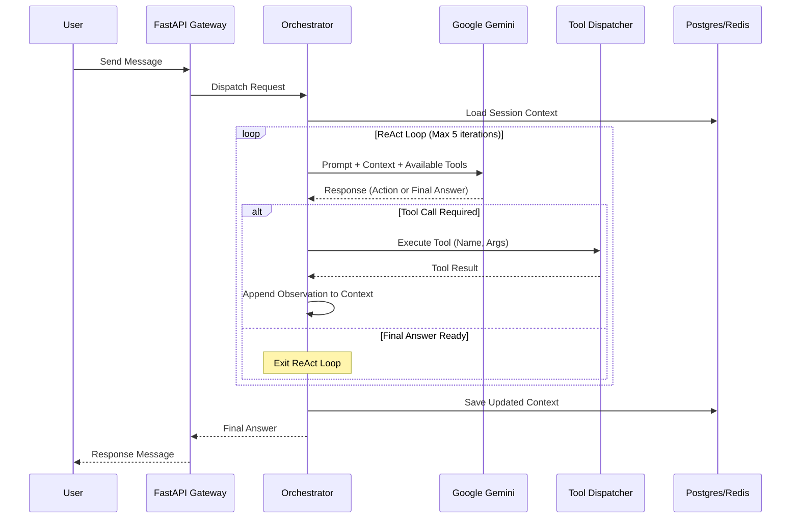

# Design & ADRs: FEAT-001 Core Agent Orchestrator

## 1. Architecture Overview
The Agent Orchestrator acts as the middle tier between the user-facing chat API and the backend tools (databases, third-party APIs). It handles context management, LLM inference, and tool execution orchestration.

### Sequence Diagram: ReAct Loop


## 2. Architecture Decision Records (ADRs)

### ADR-01: Agent Architecture Pattern
**Context:** We need a robust mechanism for the LLM to understand a query, break it down, fetch data, and provide an answer.
**Options:**
1.  **ReAct (Reason + Act):** Interleaves reasoning (thoughts) with actions (tool calls). The model decides its next move based on the previous tool's output.
2.  **Plan-and-Execute:** The model creates a complete step-by-step plan upfront, then a separate executor runs the plan.
3.  **Tree-of-Thought:** Explores multiple reasoning paths in parallel and evaluates them.
**Decision:** **ReAct loop**.
**Pros/Cons:**
*   ReAct is highly dynamic and handles unpredictable APIs well (e.g., if a transaction API returns an error, the agent can retry or adjust its approach).
*   Plan-and-Execute struggles if step 2 depends heavily on the exact output of step 1.
*   Tree-of-Thought is too slow and expensive for synchronous customer support.

### ADR-02: LLM Provider Selection & Default
**Context:** We need a foundation model capable of strong reasoning, high-quality tool calling, and long context windows. However, we should not be locked into a single provider.
**Options:**
1.  **Google Gemini (Pro/Flash):** Native function calling, massive context window (1M+ tokens), fast inference.
2.  **OpenAI GPT-4o:** Industry standard, excellent reasoning.
3.  **Anthropic Claude 3.5 Sonnet:** Excellent formatting and reasoning.
4.  **Self-hosted Open-Source (Llama 3 via Ollama):** Highest privacy, lowest ongoing cost, but high infrastructure overhead.
**Decision:** **Google Gemini API as the default provider**, accessed through an **abstract `LLMProviderBase` interface** (see ADR-05). Other providers can be swapped in via `LLM_PROVIDER` environment variable.
**Pros/Cons:**
*   Gemini offers the best cost-to-performance ratio for our specific use case, especially with its massive context window.
*   The abstraction layer adds ~100 lines of code but enables provider switching for cost optimization, A/B testing, outage resilience, and privacy-sensitive deployments.

### ADR-03: State Management Strategy
**Context:** The agent needs to remember multi-turn conversations and intermediate tool outputs.
**Options:**
1.  **In-Memory Dict:** Fast, but not scalable across multiple API instances. State is lost on restart.
2.  **Redis with TTL:** Fast, distributed, auto-expires old sessions.
3.  **PostgreSQL Conversation Table:** Persistent, robust, auditable.
**Decision:** **Redis + PostgreSQL**.
**Pros/Cons:**
*   We will use Redis to store the active, hot session state (e.g., the current ReAct scratchpad and recent messages) for fast retrieval during a live chat.
*   We will persist the finalized conversation history asynchronously to PostgreSQL for compliance, auditing, and fine-tuning purposes.

### ADR-04: Tool Calling Strategy
**Context:** How should we structure and dispatch tools to the LLM? Each LLM provider has a different function calling format.
**Options:**
1.  **Provider-Native Function Calling Only:** Use each provider's native format (Gemini's `FunctionDeclaration`, OpenAI's `tools`, etc.) directly.
2.  **LangChain / LlamaIndex Agent Framework:** Use a heavy abstraction library to manage tools across providers.
3.  **Custom Tool Router + Provider Adapters:** Build a lightweight tool registry with Pydantic schemas. Each LLM provider adapter translates the schemas to its native format.
**Decision:** **Custom Tool Router + Provider Adapters (Option 3)**.
**Pros/Cons:**
*   LangChain provides a lot out of the box but can be notoriously difficult to debug, upgrade, and customize for strict enterprise requirements (like our HITL approval flows).
*   Our custom router keeps tool definitions in one canonical Pydantic format. Each `LLMProvider` adapter converts them to the provider's native function calling format. This gives us full control AND provider flexibility.

---

### ADR-05: LLM Provider Abstraction Pattern

- **Status:** `PROPOSED`
- **Date:** 2026-09-22

#### Context & Problem Statement
The agent orchestrator must not be tightly coupled to a single LLM provider. We need the ability to switch between providers (Gemini, OpenAI, Anthropic, local models) without modifying the ReAct loop, tool calling, or state management logic. Key drivers:
- **Cost optimization** — use cheaper models (Gemini Flash) for simple queries, more powerful models (Gemini Pro) for complex investigations
- **Outage resilience** — switch providers if one has downtime
- **Privacy** — use local models (Ollama) for on-premise deployments
- **A/B testing** — compare response quality across providers

#### Options Considered
1. **Option A: Hardcoded Gemini SDK calls** — Gemini SDK calls scattered throughout orchestrator code.
   - *Pros:* Fastest to build.
   - *Cons:* Complete rewrite to switch providers. No testing seam.
2. **Option B: Abstract `LLMProviderBase` interface** — ABC with `generate()` and `generate_stream()` methods. Concrete adapters for each provider. Factory selects via `LLM_PROVIDER` env var.
   - *Pros:* Provider-agnostic orchestrator. Clean testing (mock LLM provider). Supports multi-model routing.
   - *Cons:* ~100 lines of abstraction per provider.
3. **Option C: LiteLLM / LangChain abstraction** — Use an existing multi-provider library.
   - *Pros:* Pre-built adapters for 100+ models.
   - *Cons:* Heavy dependency. Hard to customize function calling normalization. Debugging is opaque.

#### Decision Outcome & Justification
**Chosen Option:** `Option B — Abstract LLMProviderBase interface`
**Rationale:** Same adapter pattern we use for tools (FEAT-002). Lightweight, fully under our control, and enables provider-specific optimizations (e.g., Gemini's native function calling vs OpenAI's tool calling format).

#### Implementation Details

```python
# agent/llm/base.py
from abc import ABC, abstractmethod
from typing import AsyncIterator

class LLMProviderBase(ABC):
    """Abstract interface for LLM providers. The orchestrator only calls this."""
    
    @abstractmethod
    async def generate(
        self, messages: list[dict], tools: list[ToolSchema] | None = None
    ) -> LLMResponse: ...
    
    @abstractmethod
    async def generate_stream(
        self, messages: list[dict], tools: list[ToolSchema] | None = None
    ) -> AsyncIterator[LLMChunk]: ...
    
    @abstractmethod
    def get_model_name(self) -> str: ...
    
    @abstractmethod
    def get_max_tokens(self) -> int: ...

# Normalized response — orchestrator always sees this
@dataclass
class LLMResponse:
    text: str | None                    # Final answer text (None if tool call)
    tool_calls: list[ToolCall] | None   # Normalized tool calls
    finish_reason: str                  # "stop", "tool_call", "max_tokens", "safety"
    usage: TokenUsage                   # prompt_tokens, completion_tokens, total_tokens

@dataclass
class ToolCall:
    id: str              # Provider-assigned call ID
    name: str            # Tool name, e.g., "getTransaction"
    arguments: dict      # Parsed arguments
```

```python
# agent/llm/gemini.py — Default provider
class GeminiProvider(LLMProviderBase):
    def __init__(self, model: str = "gemini-2.5-flash", api_key: str = None):
        self.client = genai.Client(api_key=api_key)
        self.model = model
    
    async def generate(self, messages, tools=None):
        config = {}
        if tools:
            config["tools"] = [self._to_gemini_tool(t) for t in tools]
        response = await self.client.aio.models.generate_content(
            model=self.model, contents=messages, config=config
        )
        return self._normalize(response)
    
    def _to_gemini_tool(self, tool: ToolSchema) -> dict:
        """Convert canonical Pydantic schema → Gemini FunctionDeclaration."""
        ...
    
    def _normalize(self, response) -> LLMResponse:
        """Convert Gemini response → normalized LLMResponse."""
        ...

# agent/llm/openai.py — Alternative provider
class OpenAIProvider(LLMProviderBase):
    def __init__(self, model: str = "gpt-4o", api_key: str = None):
        self.client = AsyncOpenAI(api_key=api_key)
        self.model = model
    
    async def generate(self, messages, tools=None):
        kwargs = {"model": self.model, "messages": messages}
        if tools:
            kwargs["tools"] = [self._to_openai_tool(t) for t in tools]
        response = await self.client.chat.completions.create(**kwargs)
        return self._normalize(response)

# agent/llm/factory.py — Provider selection
class LLMProviderFactory:
    @staticmethod
    def create(provider: str = "gemini", **kwargs) -> LLMProviderBase:
        providers = {
            "gemini": GeminiProvider,
            "openai": OpenAIProvider,
            "anthropic": AnthropicProvider,
            "local": OllamaProvider,
        }
        return providers[provider](**kwargs)
```

#### Multi-Model Routing (Future)

```python
# agent/llm/router.py — Route different query types to different models
class LLMModelRouter:
    def __init__(self):
        self.simple = GeminiProvider(model="gemini-2.0-flash")   # Fast, cheap
        self.complex = GeminiProvider(model="gemini-2.5-pro")    # Powerful
    
    async def route(self, query_complexity: str, messages, tools):
        if query_complexity == "simple":  # e.g., balance check
            return await self.simple.generate(messages, tools)
        else:  # e.g., multi-step fraud investigation
            return await self.complex.generate(messages, tools)
```

#### Function Calling Format Normalization

| Provider | Tool Definition Format | How We Normalize |
| :--- | :--- | :--- |
| Gemini | `genai.types.FunctionDeclaration` | `_to_gemini_tool()` converts Pydantic → Gemini format |
| OpenAI | `{"type": "function", "function": {...}}` | `_to_openai_tool()` converts Pydantic → OpenAI format |
| Anthropic | `{"name": ..., "input_schema": {...}}` | `_to_anthropic_tool()` converts Pydantic → Anthropic format |
| Ollama | Varies by model | `_to_ollama_tool()` converts or uses raw JSON schema |

#### Consequences & Impact
- **Positive:** Provider-agnostic orchestrator. A/B testing. Cost optimization via model routing. Outage resilience.
- **Positive:** Clean testing — use a `MockLLMProvider` that returns scripted responses for deterministic tests.
- **Negative:** ~100 lines per provider adapter. Must maintain normalization layer.
- **Mitigation:** Start with Gemini only. Add OpenAI/Anthropic adapters when needed. The interface is stable.

