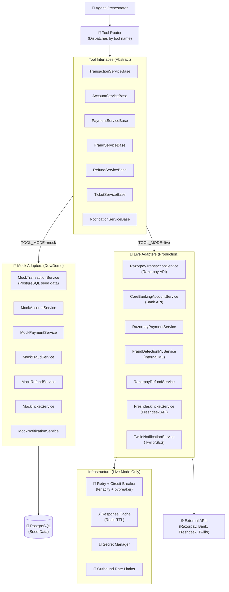
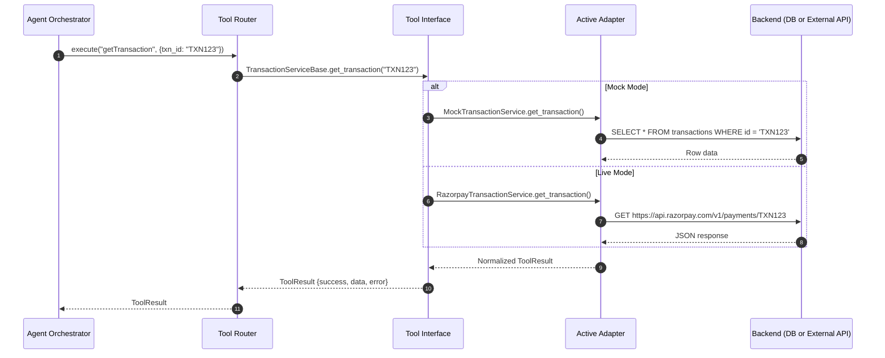
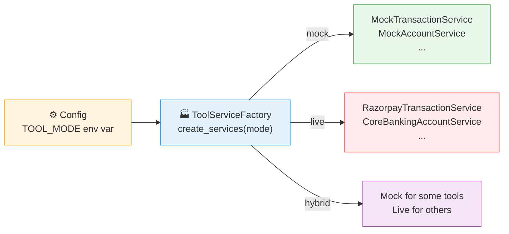

# FEAT-002-fintech-tools: Design & ADRs

> **Feature ID:** `FEAT-002-fintech-tools`  
> **Status:** `PROPOSED`  
> **Created Date:** 2026-09-18  
> **Last Updated:** 2026-09-19  
> **Specification:** [Feature Spec](./spec.md) | [Tasks](./tasks.md) | [Testing](./testing.md)

---

## 1. High-Level Design (HLD)

### Architecture Overview — Adapter Pattern

The Tool Layer uses the **Adapter Pattern** to decouple the agent from data sources. Each tool has an **abstract interface** with swappable implementations:
- **Mock Adapter:** Queries local PostgreSQL seed data (dev/demo/testing)
- **Live Adapter:** Calls real external fintech APIs (production)

The agent and tool router are completely unaware of which adapter is active — they always call the same interface.



### Tool Execution Sequence (Both Modes)



### Factory Pattern — Provider Selection



---

## 2. Architecture Decision Records (ADRs)

> [!IMPORTANT]
> Every structural decision, technology selection, or significant trade-off for this feature MUST have an ADR documented here before implementation begins.

### ADR-01: Tool Interface Pattern — Direct DB Queries vs Service Layer vs Microservice Calls

- **Status:** `PROPOSED`
- **Date:** 2026-09-18

#### Context & Problem Statement
The LLM agent needs to interact with fintech data (transactions, accounts) and trigger actions (refunds). We need a pattern to expose these capabilities cleanly without tightly coupling the LLM loop to database internals or external API specifics.

#### Options Considered
1. **Option A: Direct SQLAlchemy Queries** — Tools execute raw or ORM queries directly within the tool handler.
   - *Pros:* Simple, fast, no abstraction overhead.
   - *Cons:* Tightly couples tools to PostgreSQL. Impossible to swap to external APIs without rewriting everything. No seam for testing.
2. **Option B: Service Layer Pattern (Repository + Adapter)** — Tools call abstract service interfaces. Concrete implementations handle data access (mock DB or live API).
   - *Pros:* Clean separation. Easy testing via mocks. Supports both mock and live backends via adapter pattern. Single codebase for dev and production.
   - *Cons:* Slight abstraction overhead (~50 lines per tool).
3. **Option C: gRPC Microservices** — Tools act as clients calling external gRPC services.
   - *Pros:* Most realistic enterprise architecture.
   - *Cons:* Massive overhead for v1. Requires deploying and managing 7+ separate services.

#### Decision Outcome & Justification
**Chosen Option:** `Option B — Service Layer with Adapter Pattern`  
**Rationale:** Provides clean separation without microservice overhead. The abstract interface + concrete adapter approach allows us to build mock adapters for dev/testing and swap in live adapters for production integration with zero changes to the agent, router, or test suite.

#### Consequences & Impact
- **Positive:** Future-proof — adding a new provider (e.g., switching from Razorpay to PayU) only requires a new adapter class.
- **Negative:** Slight learning curve for the adapter pattern; need to maintain interface contracts.
- **Mitigation:** Use Python's `abc.ABC` for strict interface enforcement. Comprehensive integration tests for each adapter.

---

### ADR-02: Mock vs Real Data Strategy

- **Status:** `PROPOSED`
- **Date:** 2026-09-18

#### Context & Problem Statement
To test the agent's ability to reason over transactions and accounts, we need a consistent and realistic dataset for the mock adapter.

#### Options Considered
1. **Option A: In-memory mock data** — Hardcoded Python dictionaries.
   - *Pros:* Zero setup.
   - *Cons:* No SQL query testing, no relational integrity, diverges from production behavior.
2. **Option B: SQLite with seed data** — Lightweight DB for local dev.
   - *Pros:* SQL-compatible.
   - *Cons:* Feature mismatch with PostgreSQL (no JSONB, different timestamp handling).
3. **Option C: PostgreSQL with fixtures** — Same DB engine as production, seeded with realistic data scripts.
   - *Pros:* Full feature parity. Realistic testing of SQLAlchemy models, migrations, and JSONB queries.
   - *Cons:* Requires a running PostgreSQL instance (via Docker).

#### Decision Outcome & Justification
**Chosen Option:** `Option C — PostgreSQL with fixtures`  
**Rationale:** Same engine as production ensures no behavior drift. Docker makes setup trivial (`docker-compose up -d postgres`). Seed data covers 15+ realistic scenarios.

---

### ADR-03: Tool Schema Definition — JSON Schema vs Pydantic vs Protobuf

- **Status:** `PROPOSED`
- **Date:** 2026-09-18

#### Context & Problem Statement
Gemini function calling requires strict JSON Schema definitions for tools. We need a way to define, validate, and generate these schemas.

#### Options Considered
1. **Option A: Raw JSON schema** — Manually writing dicts matching JSON Schema spec.
   - *Pros:* No dependencies.
   - *Cons:* Error-prone, no runtime validation, tedious to maintain for 13 tools.
2. **Option B: Pydantic models** — Define inputs/outputs as Pydantic models. Use `.model_json_schema()` for auto-generation.
   - *Pros:* Type safety, runtime validation, auto JSON Schema generation, native FastAPI integration.
   - *Cons:* Pydantic v2 learning curve.
3. **Option C: Protobuf** — Define messages in `.proto` files.
   - *Pros:* Language-agnostic, strict typing.
   - *Cons:* Overkill for a Python-only project. Poor Gemini integration.

#### Decision Outcome & Justification
**Chosen Option:** `Option B — Pydantic models`  
**Rationale:** Strong typing in Python. Native integration with FastAPI. Automatic, error-free generation of JSON Schema for Gemini function calling. Built-in input validation catches bad data before it hits the service layer.

---

### ADR-04: Error Handling — Tool-Level Error Codes & Retry Strategy

- **Status:** `PROPOSED`
- **Date:** 2026-09-18

#### Context & Problem Statement
Tools may fail due to DB timeouts, invalid input, external API errors, or business rule violations. The LLM needs structured error information to decide its next action (retry, try a different tool, or tell the user).

#### Decision Outcome
1. **Standard Output Wrapper:** Every tool returns a structured response:
   ```json
   {"success": true/false, "data": {...}, "error": {"code": "...", "message": "..."}}
   ```
2. **Semantic Error Codes:** Predictable codes (`TXN_NOT_FOUND`, `INSUFFICIENT_FUNDS`, `GATEWAY_TIMEOUT`, `RATE_LIMITED`) so the LLM can branch its logic.
3. **LLM Retry Strategy:** If a tool fails with `INVALID_INPUT`, the LLM re-evaluates arguments and retries once. For `GATEWAY_TIMEOUT`, the LLM informs the user and suggests trying again later.
4. **Circuit Breaker (Live Mode):** For external API adapters, implement circuit breaker (`pybreaker`) to prevent cascading failures. After 5 consecutive failures, the circuit opens for 60 seconds.

---

### ADR-05: Backend Adapter Strategy — Mock-First with Live Swap

- **Status:** `PROPOSED`
- **Date:** 2026-09-19

#### Context & Problem Statement
The project must work as a standalone demo (with simulated data) AND be capable of integrating with real fintech providers (Razorpay, banking APIs, Freshdesk, Twilio) in production. We need a clean boundary between the agent's tool-calling logic and the actual data source.

#### Options Considered
1. **Option A: Mock-only (no abstraction)** — Build tools directly against PostgreSQL. Rewrite for production.
   - *Pros:* Fastest to build initially.
   - *Cons:* Complete rewrite needed for production. No clean testing seam.
2. **Option B: Adapter Pattern with abstract interfaces** — Define `ServiceBase` ABC for each tool. Implement `MockService` (PostgreSQL) and `LiveService` (external API) as concrete adapters. A factory selects the active adapter via `TOOL_MODE` environment variable.
   - *Pros:* Zero changes to agent/router when switching backends. Both adapters testable independently. Supports hybrid mode (some tools mock, some live).
   - *Cons:* ~50 lines of boilerplate per tool (ABC + factory wiring).
3. **Option C: Full microservices from day 1** — Each tool is a separate deployed service with its own API.
   - *Pros:* Most production-like.
   - *Cons:* Massive overhead. 7+ services to deploy, monitor, and debug for a v1.

#### Decision Outcome & Justification
**Chosen Option:** `Option B — Adapter Pattern`  
**Rationale:** The ~350 lines of total abstraction boilerplate (50 lines × 7 core tools) is a tiny cost for the massive benefit of:
- **Dev/Demo:** `TOOL_MODE=mock` → runs entirely on local PostgreSQL seed data
- **Staging:** `TOOL_MODE=hybrid` → some tools live (e.g., payment) + others mock
- **Production:** `TOOL_MODE=live` → all tools call real external APIs
- **Testing:** Mock adapters can be unit-tested with fixtures; Live adapters can be integration-tested against sandbox APIs

#### Implementation Details

```python
# tools/base.py — Abstract interface
from abc import ABC, abstractmethod
from app.core.schemas import ToolResult

class TransactionServiceBase(ABC):
    @abstractmethod
    async def get_transaction(self, txn_id: str) -> ToolResult: ...
    
    @abstractmethod
    async def get_transaction_history(self, user_id: str, **filters) -> ToolResult: ...

# tools/mock/transaction.py — Mock adapter
class MockTransactionService(TransactionServiceBase):
    def __init__(self, db_session):
        self.db = db_session
    
    async def get_transaction(self, txn_id: str) -> ToolResult:
        txn = await self.db.execute(select(Transaction).where(Transaction.id == txn_id))
        if not txn:
            return ToolResult(success=False, error={"code": "TXN_NOT_FOUND"})
        return ToolResult(success=True, data=txn.to_dict())

# tools/live/transaction.py — Live adapter (Razorpay)
class RazorpayTransactionService(TransactionServiceBase):
    def __init__(self, api_key: str, api_secret: str):
        self.client = httpx.AsyncClient(auth=(api_key, api_secret))
        self.breaker = pybreaker.CircuitBreaker(fail_max=5, reset_timeout=60)
    
    async def get_transaction(self, txn_id: str) -> ToolResult:
        try:
            resp = await self.breaker.call_async(
                self.client.get, f"https://api.razorpay.com/v1/payments/{txn_id}"
            )
            return ToolResult(success=True, data=self._normalize(resp.json()))
        except pybreaker.CircuitBreakerError:
            return ToolResult(success=False, error={"code": "SERVICE_UNAVAILABLE"})

# tools/factory.py — Factory selects adapters
class ToolServiceFactory:
    @staticmethod
    def create(mode: str, db_session=None, config=None) -> dict:
        if mode == "mock":
            return {
                "getTransaction": MockTransactionService(db_session),
                "getAccount": MockAccountService(db_session),
                ...
            }
        elif mode == "live":
            return {
                "getTransaction": RazorpayTransactionService(config.razorpay_key, ...),
                "getAccount": CoreBankingAccountService(config.bank_api_url, ...),
                ...
            }
        elif mode == "hybrid":
            return {
                "getTransaction": RazorpayTransactionService(...),  # Live
                "getAccount": MockAccountService(db_session),        # Mock
                ...
            }
```

#### Consequences & Impact
- **Positive:** Future-proof. Adding a new provider (PayU, Stripe, PhonePe) = one new adapter class. No agent/router changes.
- **Positive:** Clean testing — mock adapters tested with DB fixtures, live adapters tested against provider sandbox APIs.
- **Negative:** Slight increase in initial codebase size (~350 lines of ABC + factory boilerplate).
- **Mitigation:** Use Python's `abc.ABC` for strict enforcement. Factory pattern keeps wiring centralized.

#### Provider Mapping (Planned)

| Tool | Mock Adapter (Dev) | Live Adapter (Production) |
| :--- | :--- | :--- |
| `getTransaction` | `MockTransactionService` (PostgreSQL) | `RazorpayTransactionService` (Razorpay API) |
| `getAccount` | `MockAccountService` (PostgreSQL) | `CoreBankingAccountService` (Bank API) |
| `getPaymentStatus` | `MockPaymentService` (PostgreSQL) | `RazorpayPaymentService` (Razorpay API) |
| `checkFraudStatus` | `MockFraudService` (PostgreSQL) | `FraudDetectionMLService` (Internal ML API) |
| `getRefundStatus` | `MockRefundService` (PostgreSQL) | `RazorpayRefundService` (Razorpay API) |
| `initiateRefund` | `MockRefundService` (PostgreSQL) | `RazorpayRefundService` → HITL if > ₹10K |
| `createSupportTicket` | `MockTicketService` (PostgreSQL) | `FreshdeskTicketService` (Freshdesk API) |
| `sendNotification` | `MockNotificationService` (log only) | `TwilioNotificationService` (Twilio SMS + SES Email) |
| `searchPolicy` | Delegates to FEAT-003 RAG Engine (same in both modes) |
| `escalateToHumanAgent` | Delegates to FEAT-004 HITL System (same in both modes) |

---

## 3. Data Model & Schema (Mock Mode)

```sql
-- Core tables for mock adapter seed data
CREATE TABLE users (
    id UUID PRIMARY KEY DEFAULT gen_random_uuid(),
    name VARCHAR(255) NOT NULL,
    email VARCHAR(255) UNIQUE NOT NULL,
    phone VARCHAR(15),
    tier VARCHAR(20) DEFAULT 'standard',  -- standard, premium, vip
    kyc_status VARCHAR(20) DEFAULT 'pending',  -- pending, verified, rejected
    preferred_language VARCHAR(10) DEFAULT 'en',
    created_at TIMESTAMP DEFAULT NOW()
);

CREATE TABLE accounts (
    id UUID PRIMARY KEY DEFAULT gen_random_uuid(),
    user_id UUID REFERENCES users(id),
    balance_paise BIGINT NOT NULL DEFAULT 0,
    status VARCHAR(20) DEFAULT 'active',  -- active, frozen, closed
    account_type VARCHAR(20) DEFAULT 'savings',
    linked_cards JSONB DEFAULT '[]'
);

CREATE TABLE transactions (
    id UUID PRIMARY KEY DEFAULT gen_random_uuid(),
    user_id UUID REFERENCES users(id),
    amount_paise BIGINT NOT NULL,
    status VARCHAR(20) NOT NULL,  -- success, failed, pending, blocked
    failure_reason VARCHAR(100),
    merchant_name VARCHAR(255),
    payment_method VARCHAR(50),
    gateway_response JSONB,
    fraud_flagged BOOLEAN DEFAULT FALSE,
    risk_score DECIMAL(5,4) DEFAULT 0,
    created_at TIMESTAMP DEFAULT NOW()
);

CREATE TABLE refunds (
    id UUID PRIMARY KEY DEFAULT gen_random_uuid(),
    txn_id UUID REFERENCES transactions(id),
    amount_paise BIGINT NOT NULL,
    status VARCHAR(20) DEFAULT 'initiated',  -- initiated, processing, completed, failed, pending_approval
    reason TEXT,
    approved_by UUID,
    created_at TIMESTAMP DEFAULT NOW()
);

CREATE TABLE support_tickets (
    id UUID PRIMARY KEY DEFAULT gen_random_uuid(),
    user_id UUID REFERENCES users(id),
    category VARCHAR(50) NOT NULL,
    description TEXT NOT NULL,
    priority VARCHAR(20) DEFAULT 'low',
    status VARCHAR(20) DEFAULT 'open',
    created_at TIMESTAMP DEFAULT NOW()
);
```

---

## 4. Security & Error Handling Strategies

- **Authentication:** All tool calls are scoped to the authenticated user's session. A tool cannot access data belonging to another user (tenant isolation).
- **Response Normalization:** Both mock and live adapters return the exact same `ToolResult` schema — the agent/LLM never sees provider-specific formats.
- **Circuit Breaker (Live Mode):** `pybreaker` with `fail_max=5`, `reset_timeout=60s`. When open, tools return `SERVICE_UNAVAILABLE` error and the agent gracefully informs the user.
- **Retry Policy (Live Mode):** `tenacity` with exponential backoff (max 3 retries) for transient errors (5xx, timeouts). No retry for 4xx client errors.
- **Response Caching (Live Mode):** Redis TTL cache for read-heavy tools (e.g., `getAccount` cached for 30s, `getAccountBalance` cached for 10s). Write tools are never cached.
- **Rate Limiting:** Per-provider outbound rate limits to avoid hitting external API quotas.
