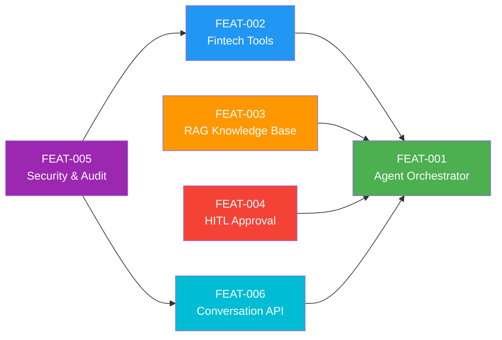

# Feature Registry Dashboard: AI Customer Support Agent

> **Last Updated:** 2026-09-18

This directory contains all individual feature modules. Each feature folder follows the standard lifecycle:
- `spec.md`: Functional scope, user stories, contracts
- `design.md`: HLD diagrams and Architecture Decision Records (ADRs)
- `tasks.md`: Phased execution checklist and current status
- `testing.md`: Test cases, automated tests, and acceptance criteria

## Active & Registered Features

| Feature ID | Feature Title | Status | Primary Action Needed | Directory Link |
| :--- | :--- | :--- | :--- | :--- |
| `FEAT-001-agent-orchestrator` | Core Agent Orchestrator (ReAct Loop + Gemini) | `COMPLETED` | Verified (104 tests passing) | [FEAT-001](./FEAT-001-agent-orchestrator/spec.md) |
| `FEAT-002-fintech-tools` | Fintech Tool Layer (Deterministic APIs) | `COMPLETED` | Verified (72 tests passing) | [FEAT-002](./FEAT-002-fintech-tools/spec.md) |
| `FEAT-003-rag-knowledge-base` | RAG Knowledge Base (Policy Search) | `PROPOSED` | Review ADRs & Design | [FEAT-003](./FEAT-003-rag-knowledge-base/spec.md) |
| `FEAT-004-hitl-approval` | Human-in-the-Loop Approval System | `PROPOSED` | Review ADRs & Design | [FEAT-004](./FEAT-004-hitl-approval/spec.md) |
| `FEAT-005-security-audit` | Security, Auth & Audit Logging | `PROPOSED` | Review ADRs & Design | [FEAT-005](./FEAT-005-security-audit/spec.md) |
| `FEAT-006-conversation-api` | Conversation API & Interface | `PROPOSED` | Review ADRs & Design | [FEAT-006](./FEAT-006-conversation-api/spec.md) |

## Feature Dependency Graph

## Implementation Order (Recommended)

1. **FEAT-005** Security & Audit → Foundation layer (auth, logging, PII masking)
2. **FEAT-002** Fintech Tools → Deterministic APIs (independent, testable)
3. **FEAT-003** RAG Knowledge Base → Policy ingestion & search
4. **FEAT-004** HITL Approval → Approval workflows & queue
5. **FEAT-001** Agent Orchestrator → Core brain integrating tools + RAG + HITL
6. **FEAT-006** Conversation API → Customer-facing interface
