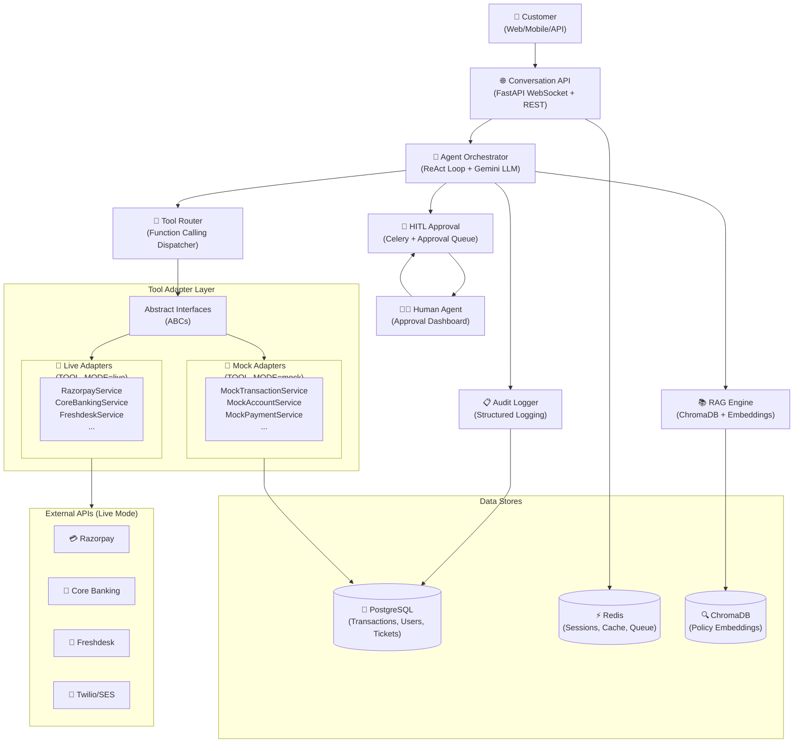
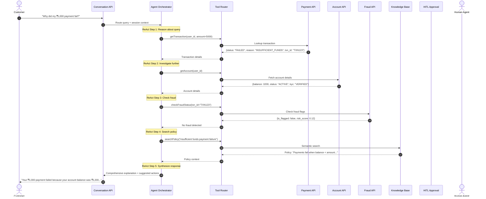

# Project Master Specification: AI Customer Support Agent

> **Last Updated:** 2026-09-19  
> **Status:** Active / Living Document  
> **Repository Root:** `c:\Users\nandi\Documents\projects\ai-customer-support-agent`

---

## 1. Executive Summary & Vision

- **Product Overview:** An intelligent, AI-powered customer support agent for fintech platforms that investigates and resolves customer queries by autonomously orchestrating deterministic tool calls against backend systems (payment, account, transaction, fraud, refund APIs), augmented with RAG-based policy search and governed by human-in-the-loop approval workflows for sensitive operations.

- **Target Audience:**
  - **Primary:** Fintech customers seeking support (payment failures, account inquiries, refund requests, fraud concerns)
  - **Secondary:** Human support agents who approve sensitive operations and handle escalations
  - **Tertiary:** Operations/compliance teams monitoring audit logs and agent performance

- **Core Value Proposition:**
  1. **Investigative Resolution:** The agent doesn't just answer — it *investigates* by calling real APIs, correlating data across systems, and providing root-cause explanations.
  2. **Human-in-the-Loop Safety:** Sensitive operations (refunds > ₹10,000, account closures, large reversals) require explicit human approval before execution.
  3. **Full Auditability:** Every agent action, tool call, decision, and approval is logged for compliance and debugging.
  4. **Sub-second Tool Calls:** Deterministic APIs respond in < 200ms; end-to-end agent responses target < 5 seconds for typical queries.

---

## 2. High-Level System Architecture

### Component Boundaries & Tech Stack

| Subsystem | Technology Stack | Primary Responsibility |
| :--- | :--- | :--- |
| **Conversation API** | Python 3.12+, FastAPI, WebSocket | Customer-facing REST + WebSocket interface, session management |
| **Agent Orchestrator** | Adapter Pattern, google-genai SDK (default), ReAct loop | LLM reasoning via `LLMProviderBase` interface — Gemini default, swappable to OpenAI/Anthropic/local |
| **Tool Layer** | Adapter Pattern, Pydantic, SQLAlchemy (mock) / httpx (live) | Deterministic API tools with swappable mock/live backends |
| **RAG Engine** | Adapter Pattern, ChromaDB, google-genai (default) | Embedding via `EmbeddingProviderBase` interface — Google default, swappable to OpenAI/local |
| **HITL Approval** | Celery, Redis (broker), FastAPI (dashboard) | Approval queue, threshold routing, timeout escalation |
| **Security & Audit** | JWT/OAuth2, structlog, PostgreSQL | Authentication, authorization, PII masking, audit trail |
| **Data & Storage** | PostgreSQL (SQLAlchemy + Alembic), Redis | Relational data, cache, sessions, message broker |
| **Infrastructure** | Docker, docker-compose | Containerized deployment, service orchestration |

---

## 3. Global Architectural Principles & Constraints

1. **Spec-First & ADR-First:** Every non-trivial feature must define its specification, design, and Architectural Decision Records (ADRs) before code execution.
2. **Agent Safety — Read-First, Write-With-Approval:** The LLM agent NEVER directly modifies the database or calls external APIs. It requests tools. Write operations (refunds, ticket creation) go through approval if they exceed thresholds.
3. **Deterministic Tools Only:** All tool APIs are deterministic functions with well-defined inputs/outputs. The LLM does not have raw database or external API access.
4. **Adapter Pattern for Tool Layer:** Every tool defines an abstract interface (ABC) with two implementations:
   - **Mock Adapter** — queries local PostgreSQL seed data (dev/demo/testing)
   - **Live Adapter** — calls real external fintech APIs (production)
   - Mode is controlled by `TOOL_MODE` environment variable (`mock`, `live`, `hybrid`)
   - The agent and tool router are completely agnostic to which adapter is active
5. **Human-in-the-Loop Thresholds:**
   - Refund > ₹10,000 → Requires human approval
   - Account closure → Always requires human approval
   - Large transaction reversal (> ₹50,000) → Requires human approval
   - Fraud flag override → Requires human approval
6. **Modular Isolation:** Each tool is an independent service with clear input/output contracts. Tools can be tested and deployed independently.
7. **Traceable Testing:** Every task in a feature plan maps to a verification test case.
8. **Audit Everything:** Every tool call, LLM decision, approval request, and response is logged with timestamps, session IDs, and user context.
9. **PII Protection:** Customer PII (Aadhaar, PAN, full account numbers) is masked in logs and LLM context. Only last-4-digits are shown.
10. **Stateless Authentication:** JWT-based auth for customers; OAuth2 for human agents.
11. **Graceful Degradation:** If the LLM is unavailable, the system falls back to rule-based responses and escalates to human agents.
12. **Resilience (Live Mode):** Circuit breakers, exponential retry, response caching, and outbound rate limiting for external API integrations.
13. **Provider-Agnostic AI:** LLM providers (Gemini, OpenAI, Anthropic, local) and embedding models (Google, OpenAI, sentence-transformers) are swappable via `LLM_PROVIDER` and `EMBED_PROVIDER` environment variables. The agent orchestrator and RAG pipeline are completely provider-agnostic — only adapter implementations change.

---

## 4. Master Feature Registry

All active, upcoming, and completed features are tracked in [`features/`](../features/):

| Feature ID | Feature Name | Owner / Lead | Status | Target Date | Spec Link |
| :--- | :--- | :--- | :--- | :--- | :--- |
| `FEAT-001-agent-orchestrator` | Core Agent Orchestrator | Team | `COMPLETED` | 2026-09-24 | [FEAT-001](../features/FEAT-001-agent-orchestrator/spec.md) |
| `FEAT-002-fintech-tools` | Fintech Tool Layer | Team | `COMPLETED` | 2026-09-23 | [FEAT-002](../features/FEAT-002-fintech-tools/spec.md) |
| `FEAT-003-rag-knowledge-base` | RAG Knowledge Base | Team | `COMPLETED` | 2026-09-26 | [FEAT-003](../features/FEAT-003-rag-knowledge-base/spec.md) |
| `FEAT-004-hitl-approval` | Human-in-the-Loop Approval | Team | `PROPOSED` | TBD | [FEAT-004](../features/FEAT-004-hitl-approval/spec.md) |
| `FEAT-005-security-audit` | Security & Audit Logging | Team | `PROPOSED` | TBD | [FEAT-005](../features/FEAT-005-security-audit/spec.md) |
| `FEAT-006-conversation-api` | Conversation API & Interface | Team | `PROPOSED` | TBD | [FEAT-006](../features/FEAT-006-conversation-api/spec.md) |

*Status Legend:* `PROPOSED` ➔ `DESIGN_READY` ➔ `IN_PROGRESS` ➔ `TESTING` ➔ `COMPLETED` ➔ `DEPRECATED`

---

## 5. Global API & Data Conventions

- **API Standards:** RESTful JSON, ISO-8601 timestamps (IST/UTC), standardized error envelopes with `{ "status": "ERROR", "error_code": "...", "message": "...", "trace_id": "..." }`.
- **Currency:** All monetary values in paise (integer) internally; formatted as ₹ for display. e.g., ₹5,000 = `500000` paise.
- **Database Migrations:** Version-controlled via Alembic. All DDL in `migrations/` directory.
- **Environment Variables:** All secrets loaded via `.env` files or secret manager. `.env.example` committed with placeholder values.
- **Logging:** Structured JSON logging via `structlog`. Every log entry includes `trace_id`, `session_id`, `user_id`, `timestamp`.
- **Error Codes:** Fintech-specific error codes (e.g., `PAYMENT_INSUFFICIENT_FUNDS`, `FRAUD_FLAGGED`, `REFUND_LIMIT_EXCEEDED`).

---

## 6. Agent Interaction Flow (End-to-End)

